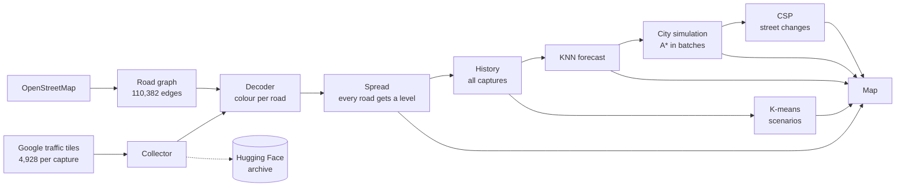

<p align="center">
  
</p>

<p align="center">
  <b>A data-driven approach to congestion-aware traffic optimization in Dhaka.</b><br>
  TRACK builds Dhaka's traffic dataset from Google's live traffic layer, then forecasts it, routes on it and plans with it.
</p>

<p align="center">
  <a href="https://cord1ess.github.io/TRACK/"></a>
  
  
  
  
  
  
</p>

<p align="center">
  <a href="#at-a-glance">At a glance</a> ·
  <a href="#results">Results</a> ·
  <a href="#how-it-works">How it works</a> ·
  <a href="#the-algorithms">Algorithms</a> ·
  <a href="#run-it">Run it</a> ·
  <a href="docs/algorithms.md">Algorithm guide</a>
</p>

---

## At a glance

<table align="center">
  <tr>
    <td align="center"><h3>2,542</h3><sub>city-wide captures</sub></td>
    <td align="center"><h3>12.5 M</h3><sub>map tiles fetched and checked</sub></td>
    <td align="center"><h3>14.5 days</h3><sub>16 Sep – 1 Oct 2026</sub></td>
    <td align="center"><h3>100 %</h3><sub>tile coverage, week 1</sub></td>
  </tr>
  <tr>
    <td align="center"><h3>110,382</h3><sub>directed roads modelled</sub></td>
    <td align="center"><h3>8,302 km</h3><sub>of road, 48,413 junctions</sub></td>
    <td align="center"><h3>131 M</h3><sub>road-level values</sub></td>
    <td align="center"><h3>4.7 B</h3><sub>traffic pixels classified</sub></td>
  </tr>
  <tr>
    <td align="center"><h3>83.8 %</h3><sub>KNN forecast accuracy</sub></td>
    <td align="center"><h3>−33 %</h3><sub>added delay, batched routing</sub></td>
    <td align="center"><h3>2,553</h3><sub>A* searches per city run</sub></td>
    <td align="center"><h3>−7.1 %</h3><sub>best Farmgate street plan</sub></td>
  </tr>
</table>

<sub>Collection figures cover both weeks. Processing figures (road-level values, pixels, results) are from week 1, 1,190 captures; week 2 is being processed.</sub>

## Results

**Dhaka's traffic, measured.** In week 1, all of Dhaka was captured every 8.8 minutes (median), and no gap was longer than 20 minutes. At 7 pm, **29 %** of the roads Google paints are red or dark red; at 6 am, **10 %**. When a road in Dhaka is slow it is usually stopped: dark red outnumbers red three to one.

**Forecasting every road.** The model learns from past captures and forecasts later ones it has never seen, scored on 1,017,776 real readings.

| Forecaster | Right level | Too green ¹ |
|---|---:|---:|
| Always clear | 65.8 % | 34.2 % |
| Same time last week | 74.0 % | 15.1 % |
| Logistic regression | 78.8 % | 13.7 % |
| **KNN** | **83.8 %** | **7.3 %** |

<sub>¹ Forecast milder than reality: the error that sends drivers into a jam.</sub>

**Routing 20,000 vehicles across the city.** Tuesday 5 pm, KNN forecast, 2,000 trips × 10 vehicles.

| | Vehicle-hours | Roads over capacity | Mean trip |
|---|---:|---:|---:|
| Before the trips | 139,858 | 6,585 | – |
| All at once: everyone takes the fastest road | 166,855 | 7,097 | 59.3 min |
| **In batches: route, add load, re-cost, repeat** | **157,859** | **6,860** | **36.9 min** |

Feedback between batches cuts the delay the new trips add by **33 %** and shortens the average trip by **38 %**. Rerouting spreads the traffic instead of moving the jam.

**Planning street changes.** A constraint search over one-ways, closures and U-turn gaps checked 783 valid layouts around Farmgate and Mohakhali and simulated each one. Around Farmgate, 55 layouts beat today's streets; the best saves **7.1 %** of vehicle-hours. Around Mohakhali none does: its through traffic stays on the main roads.

## How it works



1. **Capture.** 4,928 tiles at zoom 17 cover the metro area: about one minute at 96 requests a second, no API key, every tile validated.
2. **Decode.** Every road is sampled every 5 m, 4 px to the left of travel (Bangladesh drives on the left). It takes the colour painted on most of it: green 25, yellow 55, red 85, dark red 105.
3. **Spread.** Google paints about 9 % of the roads. Every other road takes the level of the nearest painted road along the network, one level milder per junction.
4. **Learn and simulate.** Every capture becomes one table. On it TRACK runs K-means, KNN, logistic regression, the gravity model, A* assignment and the CSP.
5. **Publish.** GitHub Actions repeats capture → pipeline → site, and every capture is archived to Hugging Face.

## The algorithms

Each is one short file under [`algorithms/track_algos/`](algorithms/track_algos/), written from scratch on NumPy. The [algorithm guide](docs/algorithms.md) walks through each one.

| Algorithm | Role | File |
|---|---|---|
| **A\*** | Fastest route on congestion-aware costs | `search/astar.py` |
| **Dijkstra** | Minutes from one place to everywhere | `search/dijkstra.py` |
| **K-means** | Finds the city's traffic scenarios from the traffic alone | `forecast/scenarios.py` |
| **KNN** | Forecasts every road for any day and time | `forecast/predict.py` |
| **Logistic regression** | The comparison forecaster | `forecast/predict.py` |
| **BPR** | Turns load into travel time, calibrated so dark red is 4× slower | `traffic/bpr.py` |
| **Gravity model** | Who travels where, between 36 zones | `simulation/demand.py` |
| **Assignment** | Thousands of A* routes, all at once vs in batches | `simulation/assignment.py` |
| **CSP** | Backtracking with forward checking over street changes | `planning/csp.py` |

## Repository

| Folder | What it does |
|---|---|
| [`data-collection/`](data-collection/) | Captures Google's traffic tiles, checks them, archives them |
| [`algorithms/`](algorithms/) | Road graph, decoder, spread, every algorithm, `pipeline.py` and `simulate.py` |
| [`visualizer/`](visualizer/) | The map: dev server, Simulate tab, and the static site for GitHub Pages |
| [`docs/`](docs/) | Algorithm guide, data collection, project plan |

## Run it

```bash
# tests
cd algorithms && pip install -r requirements.txt && python -m pytest tests -q

# one capture, then the pipeline on it
cd ../data-collection && pip install -r requirements.txt && python collector/capture.py --name my-capture
cd ../algorithms && python pipeline.py --capture ../data-collection/captures/my-capture

# over many processed captures: history -> forecast -> city -> street changes
python simulate.py history && python simulate.py forecast
python simulate.py city --trips 2000 --day tuesday --time 17:00
python simulate.py changes --area farmgate

# the map, at http://127.0.0.1:8765
cd ../visualizer && pip install -r requirements.txt && python server.py
```

The road graph ships as `algorithms/output/graph/dhaka.json.gz`, so nothing queries OpenStreetMap unless you ask. Captures and outputs are not committed.

<details>
<summary><b>Collection and deployment</b></summary>

<br>

- `collect.yml` runs capture → pipeline → site build → deploy, then starts the next run. A failed capture is retried within the run, a cron every 5 minutes revives a broken chain, and runs never overlap.
- `deploy.yml` publishes the site whenever the app or the algorithms change.
- With the `HF_TOKEN` and `HF_REPO` secrets, every capture is archived to a private Hugging Face dataset.

Setup, once: set Pages' source to GitHub Actions, add the optional secrets, run **deploy**, then run **collect** once. For a gap-free run, see [docs/keeping-collection-alive.md](docs/keeping-collection-alive.md).

</details>

## Docs

- [Algorithm guide](docs/algorithms.md): what each algorithm does, where it lives, when it runs
- [Data collection](docs/data-collection.md): how a capture works
- [Project plan](docs/project-plan.md): decisions, layout, status

---

<p align="center">
  
  <br>
  <sub>Roads from OpenStreetMap © OpenStreetMap contributors. Traffic from Google's public traffic layer; Google's terms do not allow storing its tiles, a risk the project owner accepted for academic use.</sub>
</p>
